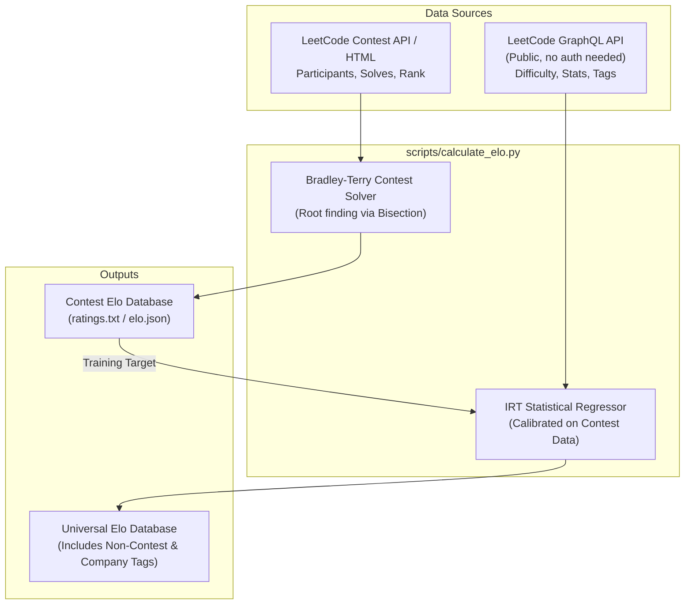

# Reverse Engineering LeetCode Problem Elo Ratings

This document outlines the mathematical foundation, system design, and implementation roadmap to compute LeetCode problem Elo ratings independently without relying on third-party sources like `zerotrac`.

---

## 1. Mathematical Foundation

### 1.1 The Contest Equilibrium (Bradley-Terry / Elo Model)

In competitive programming rating systems (e.g., Codeforces, TopCoder, and zerotrac), a problem's Elo rating $R_p$ is defined as:

> **A problem has Elo rating $R_p$ if a participant with contest rating $R_c = R_p$ has an expected solve probability of exactly $50\%$ ($0.5$).**

Under the standard logistic Elo formulation, the probability that user $i$ (with contest rating $R_i$) solves problem $j$ (with problem rating $R_j$) is:

$$P(\text{solve}_{i,j}) = \frac{1}{1 + 10^{(R_j - R_i) / 400}}$$

In natural exponent form:

$$P(\text{solve}_{i,j}) = \frac{1}{1 + e^{\frac{\ln(10)}{400}(R_j - R_i)}} = \sigma\left( \frac{\ln(10)}{400}(R_i - R_j) \right)$$

### 1.2 Maximum Likelihood Estimation & Root Finding

For a contest with $N$ active participants where the pre-contest ratings are known:

$$R_{\text{users}} = [R_1, R_2, \dots, R_N]$$

If problem $j$ was successfully solved by exactly $S_j$ participants, the expected number of total solves $E[S_j]$ must equal the observed count $S_j$:

$$f(R_j) = \sum_{i=1}^N \frac{1}{1 + 10^{(R_j - R_i) / 400}} - S_j = 0$$

#### Properties of $f(R_j)$:
1. **Strictly Monotonically Decreasing:** $\frac{\partial f}{\partial R_j} < 0$ for all $R_j$.
2. **Guaranteed Unique Root:** For any $0 < S_j < N$, there exists exactly one real root $R_j^* \in (-\infty, \infty)$.
3. **Efficient Convergence:** The root can be found using standard binary search (bisection) over $[800, 3500]$ in under 25 iterations to achieve $< 0.01$ precision:

```python
def solve_problem_elo(user_ratings: list[float], solves: int) -> float:
    low, high = 800.0, 3500.0
    for _ in range(30):
        mid = (low + high) / 2.0
        expected = sum(1.0 / (1.0 + 10.0 ** ((mid - r) / 400.0)) for r in user_ratings)
        if expected > solves:
            low = mid
        else:
            high = mid
    return round((low + high) / 2.0, 1)
```

---

## 2. Universal Problem Rating: Item Response Theory (IRT) Model

### Why Contest-Only Elo is Insufficient
Contest equilibrium math only works on problems tested in official weekly/biweekly contests. Classic interview staples (e.g., *LRU Cache*, *Word Ladder*, *Alien Dictionary*, and questions from Stripe, Citadel, Jane Street) were never contest questions and therefore cannot be rated with contest standings alone.

### The Statistical IRT Formulation
We can train a generalized additive regression model / IRT 2-Parameter Logistic (2PL) model using the ~2,500 problems that have both known contest ratings and LeetCode GraphQL public metrics:

$$R_p \approx \alpha_{\text{diff}} + \beta_1 \cdot \text{logit}(\text{acRate}) + \beta_2 \cdot \log(\text{submissions}) + \sum_{k} \gamma_k \cdot \text{Topic}_k$$

Where:
* $\text{diff} \in \{\text{Easy}, \text{Medium}, \text{Hard}\}$ establishes the baseline intercept $\alpha_{\text{diff}}$.
* $\text{acRate} = \frac{\text{totalAcceptedRaw}}{\text{totalSubmissionRaw}}$ acts as the primary difficulty discriminator.
* $\text{Topic}_k$ applies topic-specific adjustments (e.g., Dynamic Programming and Segment Tree problems typically carry an Elo premium relative to simple Array/String problems at the same acceptance rate).

---

## 3. Architecture & Data Pipeline



---

## 4. Implementation Plan for Future Session

1. **Crawler Component:**
   * Script to query LeetCode GraphQL for question metadata (`titleSlug`, `difficulty`, `stats`, `topicTags`).
   * Optional contest scraper for weekly/biweekly contest standings.
2. **Model Training Script (`scripts/train_elo_model.py`):**
   * Extract features from `ratings.txt` joined with GraphQL stats.
   * Fit linear/ridge/gradient-boosted models and export coefficients as a lightweight JSON artifact.
3. **Inference Pipeline:**
   * Given any problem slug or ID, predict its rating using contest ground truth when available, or IRT estimation as fallback.
   * Provide uncertainty/confidence intervals (e.g., `±35 Elo`).

